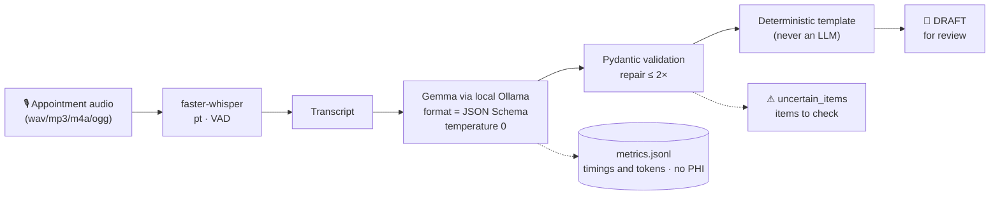

# DentaNote 🦷

> 🇧🇷 This is the English version. [Versão em português](README.md).

**Writing the note for every appointment costs a dentist 3 to 10 minutes of the
day** — time that adds up in administrative overhead. **DentaNote transcribes
the appointment recording with an open-source AI model running on your machine
and returns a clinical note draft for you to review**, without a single piece
of patient data leaving the computer.

<!-- [INSERIR: badges after publishing — e.g.  ·  · Python 3.11+ ] -->

---

## 1. Demo

> **[INSERIR: short GIF/video (~30 s)]** — screen recording: interface →
> *✨ Load synthetic sample* → tabs 2 to 5 → draft copied. Meanwhile, the same
> end-to-end run in a terminal (100% synthetic data):

```console
$ uv run dentanote run data/synthetic/audio/restauracao_classe_I.wav

Transcribed: 29.6s of audio in 7.7s (whisper small).
CLINICAL NOTE — DRAFT generated by local AI. Review before saving to the record.

**Teeth**
- 36 (O) — composite resin restoration, class I

**Procedures**
- composite resin restoration - tooth 36 (class I)
...
⚠ Review before saving
- item discarded during validation: invalid tooth number discarded: 56

Draft generated by local AI (gemma4:e4b). Review before saving to the record.
```

The audio above is **synthetic**: an offline TTS reading a fictional transcript
(`scripts/make_synthetic_audio.py`). No real patient took part in any
production, test or demo of this repository.

## 2. Why local and open-source (and not a record-keeping SaaS)

1. **Privacy / LGPD** (Brazil's data protection law): appointment audio is
   sensitive health data. Here it never leaves your computer — the only
   connection is to `http://localhost:11434` (the Ollama server itself). An
   automated test blocks any external socket.
2. **Works offline**: after downloading the models, unplug the internet. The
   whole pipeline — transcription, extraction and drafting — keeps working.
3. **Zero cost after setup**: no subscription, no token quota, no account.
4. **Swappable, auditable models**: swap `gemma4:e4b` for `gemma3:4b` (or any
   other Ollama model) with one environment variable and compare them yourself
   with `dentanote eval`. MIT-licensed code: you can read what the system does.

**Conceptual comparison with cloud services** (no cloud API exists in this
project): a SaaS sends the audio/text to third-party servers — internet
dependence, recurring per-appointment cost, and a retention policy you don't
control. DentaNote removes all three, in exchange for you managing the model
downloads and the local hardware.

## 3. How it works



Four decisions hold the quality (details in
[docs/architecture.md](docs/architecture.md) and ADRs in
[docs/AGILE.md](docs/AGILE.md)):

- **Mandatory structured output**: Ollama receives the `ClinicalNote` JSON
  Schema (`format`) with `think=false` — and Pydantic still validates on the
  client, because "thinking" models can skip the schema.
- **Deterministic template in the final step**: the final draft is a PT-BR
  template that only transcribes already-validated fields. A field that was
  not said = `null`/empty list. Nothing is inferred, nothing is invented.
- **`uncertain_items` as a safety valve**: an ambiguous tooth number or an
  unintelligible passage becomes an item listed for the professional to check —
  an invalid FDI number is discarded and logged, never silently "fixed".
- **Failure becomes a warning**: up to 2 repair attempts sending the validation
  error back to the model; if it persists, a partial result with a clear
  warning — never a raw exception on your screen.

## 4. Installation

**Requirements:** Python 3.11+, [Ollama](https://ollama.com) installed and
running, `uv` (or pip). GPU is optional (Whisper falls back to CPU
automatically if the CUDA stack is unavailable).

```bash
git clone https://github.com/<user>/anotadordental.git
cd anotadordental

uv sync                        # without uv: python -m venv .venv && pip install -e .

ollama pull gemma4:e4b         # default model (once; ~6.6 GB)
# lighter alternative: ollama pull gemma3:4b

uv run dentanote doctor        # ✔ Ollama · model · GPU · Whisper cache · metrics
```

`doctor` tells you exactly what is missing and the command to fix it (e.g.
`ollama pull gemma4:e4b`).

| Variable | Default | What for |
| --- | --- | --- |
| `DENTANOTE_LLM_MODEL` | `gemma4:e4b` | Ollama model used for extraction |
| `DENTANOTE_OLLAMA_URL` | `http://localhost:11434` | Ollama endpoint (don't point it at the cloud!) |
| `DENTANOTE_WHISPER_MODEL` | `small` | transcription model (`medium` = more accurate, slower) |
| `DENTANOTE_WHISPER_DEVICE` | `auto` | `cpu`/`cuda` to force the device |
| `DENTANOTE_METRICS_PATH` | `metrics.jsonl` | metrics file (no PHI) |

> **How the default model was chosen:** the project brief asked for "the most
> recent Gemma version available in Ollama"; `ollama list` on this machine
> showed `gemma4:e4b` (7.5 B) as the most recent — `gemma3:4b` is documented as
> the alternative (ADR-005).

Synthetic audio to try the demo (optional):

```bash
uv sync --extra tts
uv run python scripts/make_synthetic_audio.py     # generates data/synthetic/audio/*.wav
```

## 5. Usage

### Interface (main)

```bash
uv run streamlit run src/dentanote/app.py
```

Five tabs following the workflow: **Input** (upload, browser recording or
pasted text — with a *✨ Load synthetic sample* button for the 1-click demo) →
editable **Transcript** → editable **Structured data** → **Clinical note**
(copy/download) → **Metrics**. The UI toggles PT/EN in the header (default
PT-BR; the rendered note stays in PT-BR clinical format, the standard for
Brazilian records). The warning *"AI-generated clinical note draft. Review
before saving to the record. No data leaves this computer"* stays visible at
all times, and `uncertain_items` entries are highlighted ⚠.

You are the final authority: any edit in the transcript or structured data
feeds the text in the last tab — and the last step is a template, never the
model "rewriting" on its own.

### CLI (secondary)

```bash
uv run dentanote run visit.wav                   # audio -> draft (or -o file.txt)
uv run dentanote text transcript.txt             # I already have the text
uv run dentanote text transcript.txt --json      # structured output
uv run dentanote doctor                          # diagnose the environment
uv run dentanote eval                            # evaluate the default model -> docs/results.md
uv run dentanote eval --models gemma4:e4b --models gemma3:4b
uv run dentanote eval --mock                     # validate the harness without a model
```

Every output is labeled as a draft, and logs/metrics (`metrics.jsonl`) store
only timings, tokens, sizes and attempt counts — never clinical text (an
automated test guarantees that).

### Evaluation

```bash
uv run python scripts/evaluate.py --models gemma4:e4b --models gemma3:4b
```

Runs the 12 synthetic transcripts in `data/synthetic/transcripts` against
`data/synthetic/expected/` and writes [docs/results.md](docs/results.md)
(precision/recall/F1, hallucination, `uncertain_items` usage, latencies,
tokens/s).

## 6. Evaluation results

Measured on **100% synthetic data** (12 cases), a Ryzen/RTX 5050 machine with
local Ollama — reproduce with the command above:

| Model | Valid JSON 1st try | FDI teeth F1 | Procedures F1 | Medications F1 | Hallucination | Avg. latency (extraction) |
| --- | --- | --- | --- | --- | --- | --- |
| `gemma4:e4b` (default) | 100% | 0.92 | 0.89 | 1.00 | 11.1% | 1.70 s |
| `gemma3:4b` (alternative) | 100% | 0.75 | 0.65 | 0.92 | 31.8% | 5.59 s |

Full tables (p95, tokens/s, memory) in [docs/results.md](docs/results.md).

**End-to-end demo** (29.6 s of synthetic audio → Whisper `small` on **CPU** →
`gemma4:e4b` via Ollama with local GPU): transcription 7.7 s + extraction
2.1 s = **11.2 s from recording to draft**, about 2.6× faster than the audio
itself. A second case (urgent pain, 25.9 s of audio) took 10.2 s — both with
valid JSON on the first attempt and 0 repairs. On a machine without a GPU,
extraction is the only stage that grows (the model is 7.5 B); transcription and
rendering stay the same.

## 7. Honest limitations

- **It's a draft, not the truth**: in tests the model got a tooth number wrong
  (predicted 37 where the audio said 47, case `urgencia_dor`) and used "pulp
  chamber opening" wording in a non-endodontics case. That's why human review
  is mandatory and doubtful items go to `uncertain_items`.
- An 11.1% hallucination rate (best model) means ~1 in 9 extracted items was
  not in the reference — field-by-field checking is part of the workflow.
- The evaluation covers **a synthetic corpus of 12 cases** in PT-BR with
  controlled vocabulary; it is neither a clinical study nor regulatory
  validation.
- Transcription depends on audio quality: a bad microphone and overlapping
  speech degrade Whisper (which is why the transcript is the first editable
  tab).
- The initial model download needs the internet — after that, offline.

## 8. Legal and ethical notice

DentaNote is an **administrative support tool**. The generated draft **is not a
diagnosis, suggests no treatment and does not replace the clinical judgment**
of a licensed professional — you sign the note. Do not use real patient data
without first assessing compliance with **LGPD** and the rules of your
professional council (CFO/CRF of origin). This project performs no collection,
storage or sending of data to third-party services; any adaptation that changes
that requires explicit review (see [SECURITY.md](SECURITY.md)).

## 9. Roadmap and how to contribute

Roadmap (by importance, no promised dates):

- [ ] More synthetic scenarios (implantology, periodontology, orthodontics)
      and per-specialty evaluation
- [ ] Other languages support (prompt/transcription/rendering) and TTS voices
- [ ] Final interface screenshots/GIFs and dark mode
- [ ] Direct export to common record formats (text/JSON)
- [ ] Performance comparison on modest CPUs (community benchmarks)

Contributions are welcome — see [CONTRIBUTING.md](CONTRIBUTING.md) (setup,
verification commands and the four non-negotiable rules) and
[SECURITY.md](SECURITY.md) (**never** open an issue with real patient data).
The backlog and design decisions live in [docs/AGILE.md](docs/AGILE.md).

## License

[MIT](LICENSE) — open source to audit, adapt and distribute.
