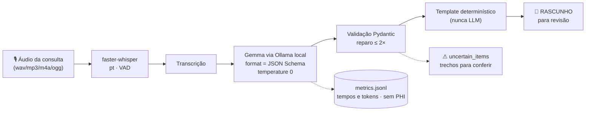

# DentaNote 🦷

**Redigir a evolução de cada consulta consome de 3 a 10 minutos do dia do dentista** —
tempo esse que some em tarefas administrativas. **O DentaNote transcreve a gravação
da consulta com um modelo de IA open-source rodando na sua máquina e devolve um
rascunho de evolução clínica para você revisar**, sem que um único dado de paciente
saia do computador.

<!-- [INSERIR: badges após publicar — ex.:  ·  · Python 3.11+ ] -->

---

## 1. Demo

> **[INSERIR: GIF/vídeo curto (~30 s)]** — gravação da tela: interface → botão
> *✨ Carregar exemplo sintético* → abas 2 a 5 → rascunho copiado. Enquanto isso,
> a mesma ponta a ponta em terminal (dados 100% sintéticos):

```console
$ uv run dentanote run data/synthetic/audio/restauracao_classe_I.wav

Transcrito: 29.6s de áudio em 7.7s (whisper small).
EVOLUÇÃO CLÍNICA — RASCUNHO gerado por IA local. Revise antes de salvar no prontuário.

**Dentes**
- 36 (O) — restauração em resina composta, classe I

**Procedimentos**
- restauração em resina — dente(s) 36 (classe I)
...
⚠ Conferir antes de salvar
- item descartado na validação: número de dente inválido descartado: 56

Rascunho gerado por IA local (gemma4:e4b). Revise antes de salvar no prontuário.
```

O áudio acima é **sintético**: um TTS offline lendo uma transcrição fictícia
(`scripts/make_synthetic_audio.py`). Nenhum paciente real entrou em produção,
teste ou demo deste repositório.

## 2. Por que local e open-source (e não um SaaS de prontuário)

1. **Privacidade/LGPD**: gravação de consulta é dado sensível de saúde. Aqui ela
   não sai do seu computador — a única conexão é com `http://localhost:11434`
   (o próprio Ollama). Teste automatizado bloqueia qualquer socket externo.
2. **Funciona offline**: depois de baixar os modelos, desligue a internet. O
   pipeline inteiro — transcrição, extração e redação — continua funcionando.
3. **Custo zero após a configuração**: sem mensalidade, sem cota de tokens, sem
   conta para criar.
4. **Modelos trocáveis e auditáveis**: troque `gemma4:e4b` por `gemma3:4b` (ou
   qualquer outro do Ollama) com uma variável de ambiente e compare você mesmo
   com `dentanote eval`. Código aberto MIT: dá para ler o que o sistema faz.

**Comparação conceitual com serviços de nuvem** (sem nenhuma API de nuvem neste
projeto): um SaaS envia o áudio/texto para servidores de terceiros — dependência
de internet, custo recorrente por consulta e política de retenção que você não
controla. O DentaNote elimina as três, em troca de você gerenciar o download dos
modelos e o hardware local.

## 3. Como funciona



Quatro decisões seguram a qualidade (detalhes em
[docs/architecture.md](docs/architecture.md) e ADRs em [docs/AGILE.md](AGILE.md)):

- **Saída estruturada obrigatória**: o Ollama recebe o JSON Schema do
  `ClinicalNote` (`format`) e `think=false` — e mesmo assim o Pydantic valida no
  cliente, porque modelos "thinking" podem ignorar o schema.
- **Template determinístico na etapa final**: a redação final é um template em
  PT-BR que só transcreve campos já validados. Campo não dito = `null`/lista
  vazia. Nada é inferido, nada é inventado.
- **`uncertain_items` como válvula de segurança**: número de dente ambíguo ou
  trecho ilegível vira item listado para o profissional conferir — FDI inválido
  é descartado e registrado, nunca "consertado" em silêncio.
- **Falha vira aviso**: até 2 tentativas de reparo enviando o erro de validação
  de volta ao modelo; se persistir, resultado parcial com aviso claro — nunca
  exceção crua na sua tela.

## 4. Instalação

**Requisitos:** Python 3.11+, [Ollama](https://ollama.com) instalado e rodando,
`uv` (ou pip). GPU é opcional (o Whisper cai para CPU automaticamente se a
pilha CUDA não estiver disponível).

```bash
git clone https://github.com/<usuario>/anotadordental.git
cd anotadordental

uv sync                        # alternativa sem uv: python -m venv .venv && pip install -e .

ollama pull gemma4:e4b         # modelo padrão (uma vez; ~6,6 GB)
# alternativa mais leve: ollama pull gemma3:4b

uv run dentanote doctor        # ✔ Ollama · modelo · GPU · cache do Whisper · métricas
```

O `doctor` diz exatamente o que falta e o comando para corrigir (ex.:
`ollama pull gemma4:e4b`).

| Variável | Padrão | Para quê |
| --- | --- | --- |
| `DENTANOTE_LLM_MODEL` | `gemma4:e4b` | modelo do Ollama usado na extração |
| `DENTANOTE_OLLAMA_URL` | `http://localhost:11434` | endpoint do Ollama (não mude para a nuvem!) |
| `DENTANOTE_WHISPER_MODEL` | `small` | modelo de transcrição (`medium` = mais preciso, mais lento) |
| `DENTANOTE_WHISPER_DEVICE` | `auto` | `cpu`/`cuda` para forçar o dispositivo |
| `DENTANOTE_METRICS_PATH` | `metrics.jsonl` | arquivo de métricas (sem PHI) |

> **Modelo padrão escolhido assim:** o PROMPT pede "a versão mais recente de
> Gemma disponível no Ollama"; verificamos com `ollama list` nesta máquina e
> `gemma4:e4b` (7,5 B) era a mais recente — `gemma3:4b` fica documentado como
> alternativa (ADR-005).

Áudio sintético para testar a demo (opcional):

```bash
uv sync --extra tts
uv run python scripts/make_synthetic_audio.py     # gera data/synthetic/audio/*.wav
```

## 5. Uso

### Interface (principal)

```bash
uv run streamlit run src/dentanote/app.py
```

Cinco abas seguindo o fluxo: **Entrada** (upload, gravação do navegador ou texto
colado — com botão *✨ Carregar exemplo sintético* para a demo em 1 clique) →
**Transcrição** editável → **Dados estruturados** editáveis → **Evolução
clínica** (com copiar/baixar) → **Métricas**. O aviso *"Rascunho gerado por IA
local. Revise antes de salvar no prontuário. Nenhum dado sai deste computador"*
fica visível o tempo todo, e os itens de `uncertain_items` aparecem destacados ⚠.

Você é a autoridade final: qualquer edição na transcrição ou nos dados
estruturados alimenta o texto da última aba — e a última etapa é um template,
nunca o modelo "reescrevendo" por conta própria.

### CLI (secundária)

```bash
uv run dentanote run consulta.wav                 # áudio -> rascunho (ou -o arquivo.txt)
uv run dentanote text transcricao.txt             # já tenho o texto
uv run dentanote text transcricao.txt --json      # saída estruturada
uv run dentanote doctor                           # diagnostica o ambiente
uv run dentanote eval                             # avalia o modelo padrão -> docs/results.md
uv run dentanote eval --models gemma4:e4b --models gemma3:4b
uv run dentanote eval --mock                      # valida o avaliador sem modelo
```

Toda saída vem rotulada como rascunho, e os logs/métricas (`metrics.jsonl`)
guardam apenas tempos, tokens, tamanhos e tentativas — nunca texto clínico
(há teste automatizado garantindo isso).

### Avaliação

```bash
uv run python scripts/evaluate.py --models gemma4:e4b --models gemma3:4b
```

Roda as 12 transcrições sintéticas de `data/synthetic/transcripts` contra
`data/synthetic/expected/` e grava [docs/results.md](docs/results.md)
(precisão/recall/F1, alucinação, uso de `uncertain_items`, latências, tokens/s).

## 6. Resultados da avaliação

Medidos em **dados 100% sintéticos** (12 casos), máquina com Ryzen/RTX 5050,
Ollama local — reproduce com o comando acima:

| Modelo | JSON válido 1ª tentativa | F1 dentes FDI | F1 procedimentos | F1 medicamentos | Alucinação | Latência média (extração) |
| --- | --- | --- | --- | --- | --- | --- |
| `gemma4:e4b` (padrão) | 100% | 0,92 | 0,89 | 1,00 | 11,1% | 1,70 s |
| `gemma3:4b` (alternativa) | 100% | 0,75 | 0,65 | 0,92 | 31,8% | 5,59 s |

Tabelas completas (p95, tokens/s, memória) em [docs/results.md](docs/results.md).

**Demo ponta a ponta** (áudio sintético de 29,6 s → Whisper `small` em **CPU** →
`gemma4:e4b` via Ollama com GPU local): transcrição 7,7 s + extração 2,1 s =
**11,2 s de gravação a rascunho**, ou seja, ~2,6× mais rápido que o próprio
áudio. Um segundo caso (urgência com dor, 25,9 s de áudio) levou 10,2 s — os
dois com JSON válido na 1ª tentativa e 0 reparos. Em máquina sem GPU a
extração é a única etapa que cresce (o modelo tem 7,5 B); transcrição e
renderização continuam iguais.

## 7. Limitações honestas

- **É rascunho, não verdade**: nos testes o modelo errou o número de um dente
  (previu 37 onde o áudio dizia 47, caso `urgencia_dor`) e usou "abertura de
  câmara pulpar" num caso fora de endodontia. Por isso a revisão humana é
  obrigatória e os itens duvidosos vão para `uncertain_items`.
- Alucinação de 11,1% (melhor modelo) significa que ~1 em cada 9 itens extraídos
  não estava no esperado — conferência campo a campo faz parte do fluxo.
- A avaliação é sobre **um corpus sintético de 12 casos** em PT-BR com
  vocabulário controlado; não é estudo clínico nem validação regulatória.
- Transcrição depende da qualidade do áudio: microfone ruim e fala sobreposta
  degradam o Whisper (por isso a transcrição é a primeira aba editável).
- O download inicial dos modelos precisa de internet — depois disso, offline.

## 8. Aviso legal e ético

O DentaNote é uma **ferramenta de apoio administrativo**. O rascunho gerado
**não é diagnóstico, não sugere conduta e não substitui o julgamento clínico**
de profissional habilitado — quem assina a evolução é você. Não use dados reais
de pacientes sem antes avaliar conformidade com a **LGPD** e com as normas do
seu conselho profissional (CFO/CRF-origem). Este projeto não realiza coleta,
armazenamento ou envio de dados a serviços terceiros; qualquer adaptação que
mude isso precisa de revisão explícita (ver [SECURITY.md](SECURITY.md)).

## 9. Roadmap e como contribuir

Roadmap (ordem de importância, sem prazo prometido):

- [ ] Mais cenários sintéticos (implantodontia, periodontia, ortodontia) e
      avaliação por especialidade
- [ ] Suporte a outros idiomas (prompt/transcrição/renderização) e vozes TTS
- [ ] Prints/GIFs finais da interface e modo tema escuro
- [ ] Exportação direta para formatos comuns de prontuário (texto/JSON)
- [ ] Comparativo de desempenho em CPUs modestas (benchmarks comunitários)

Contribuições são bem-vindas — veja [CONTRIBUTING.md](CONTRIBUTING.md) (setup,
comandos de verificação e as quatro regras que não se negociam) e
[SECURITY.md](SECURITY.md) (**nunca** abra issue com dado real de paciente).
O backlog e as decisões de design vivem em [docs/AGILE.md](docs/AGILE.md).

## Licença

[MIT](LICENSE) — código aberto para auditar, adaptar e distribuir.
