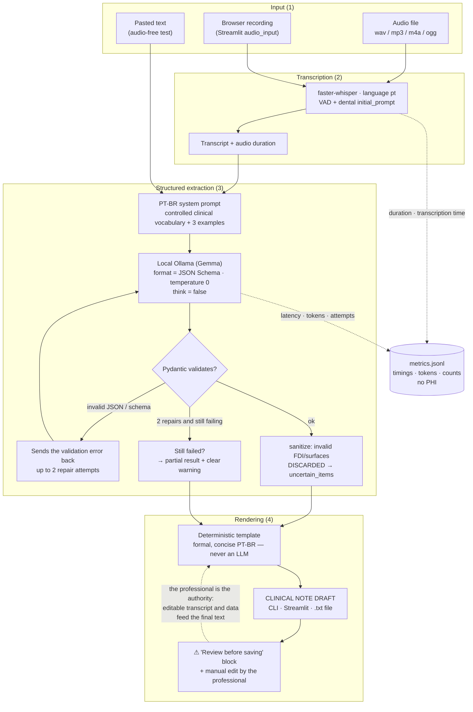

# Architecture — DentaNote

> 🇧🇷 [Versão em português](architecture.md).

A 100% local pipeline: audio (or text) in, **revisable draft** out. The only
service the program talks to is the Ollama server on the same machine
(`http://localhost:11434`); once the models are downloaded, nothing travels
outside the computer.

## Flow diagram

## Modules and responsibilities

| Module | Responsibility | Related decision |
| --- | --- | --- |
| `config.py` | Settings via `DENTANOTE_*`/`.env` (pydantic-settings) | everything points to localhost by default |
| `schema.py` | Pydantic models (FDI, surfaces) + Ollama JSON Schema | invalid FDI is discarded, never "fixed" |
| `prompts.py` | System prompt, 3 few-shot examples, vocabulary | canonical procedure vocabulary |
| `transcribe.py` | faster-whisper wrapper (pt, VAD, initial_prompt) | the only place that may download a model (once) |
| `extract.py` | Ollama client, parse, sanitize, repair ≤ 2 | ADR-001 (`format`+`think=false`), ADR-003/004 |
| `render.py` | JSON → note text (template) | **ADR-002: never an LLM at this step** |
| `pipeline.py` | Orchestrates the stages + builds metrics | always returns a draft + warnings |
| `metrics.py` | `metrics.jsonl` without PHI (key guard) | ADR-006 |
| `evaluation.py` | F1/hallucination/latency over the synthetic corpus | tolerant matching (Jaccard ≥ 0.5) |
| `doctor.py` | Environment diagnosis (`dentanote doctor`) | — |
| `cli.py` / `app.py` | typer (run/text/eval/doctor) and Streamlit (5 tabs) | draft warning always visible |

The short ADRs (001–006) and the process retrospective live in
[docs/AGILE.md](../AGILE.md) (PT-BR).

## Why the end of the pipeline can be trusted

1. **Schema on the output** (`format` + JSON Schema) reduces invalid JSON —
   measured at 100% first-attempt in both real runs.
2. **Client-side validation always**: a "thinking" model may skip the schema;
   Pydantic is who approves (ADR-001).
3. **Uncertainty is explicit**: an ambiguous number is not guessed — it lands
   in `uncertain_items` and is highlighted ⚠ (ADR-003).
4. **The last step is a template**: no LLM "writing prettily" — text that was
   not mentioned simply doesn't exist in the draft (ADR-002).
5. **Failure becomes a warning**: two repairs and then a labeled partial
   result, no raw exception on the user's screen (ADR-004).
