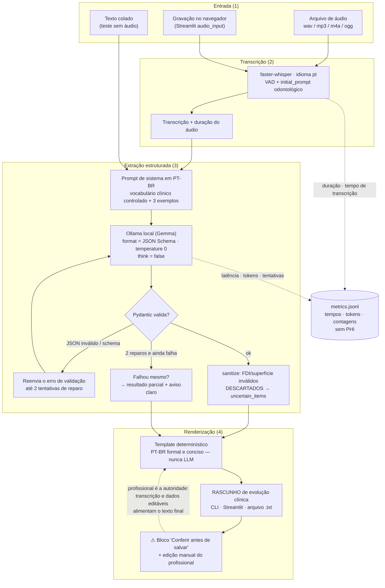

# Arquitetura — DentaNote

Pipeline 100% local: áudio (ou texto) entra, **rascunho revisável** sai. O único
serviço com quem o programa fala é o Ollama na própria máquina
(`http://localhost:11434`); depois que os modelos estão baixados, nada trafega
para fora do computador.

## Diagrama de fluxo

## Módulos e responsabilidades

| Módulo | Responsabilidade | Decisão relacionada |
| --- | --- | --- |
| `config.py` | Settings via `DENTANOTE_*`/`.env` (pydantic-settings) | tudo aponta para localhost por padrão |
| `schema.py` | Modelos Pydantic (FDI, superfícies) + JSON Schema do Ollama | FDI inválido é descartado, nunca "consertado" |
| `prompts.py` | Prompt de sistema, 3 exemplos few-shot, vocabulário | vocabulário canônico de procedimentos |
| `transcribe.py` | Wrapper do faster-whisper (pt, VAD, initial_prompt) | único ponto que pode baixar modelo (uma vez) |
| `extract.py` | Cliente Ollama, parse, sanitize, reparo ≤ 2 | ADR-001 (`format`+`think=false`), ADR-003/004 |
| `render.py` | JSON → texto de evolução (template) | **ADR-002: nunca LLM nesta etapa** |
| `pipeline.py` | Orquestra etapas + monta métricas | sempre devolve rascunho + avisos |
| `metrics.py` | `metrics.jsonl` sem PHI (guard de chaves) | ADR-006 |
| `evaluation.py` | F1/alucinação/latência sobre o corpus sintético | matching tolerante (Jaccard ≥ 0,5) |
| `doctor.py` | Diagnóstico do ambiente (`dentanote doctor`) | — |
| `cli.py` / `app.py` | typer (run/text/eval/doctor) e Streamlit (5 abas) | aviso de rascunho sempre visível |

Os ADRs curtos (001–006) e a retrospectiva de processo estão em
[docs/AGILE.md](AGILE.md).

## Por que dá para confiar no final do pipeline

1. **Schema na saída** (`format` + JSON Schema) reduz JSON inválido —
   medido em 100% de primeira tentativa nas duas rodadas reais.
2. **Validação client-side sempre**: o modelo "thinking" pode ignorar o schema;
   o Pydantic é quem aprova (ADR-001).
3. **Incerteza é explícita**: número ambíguo não é adivinhado — cai em
   `uncertain_items` e aparece em destaque ⚠ (ADR-003).
4. **Última etapa é um template**: nada de LLM para "escrever bonito" — texto
   não mencionado simplesmente não existe no rascunho (ADR-002).
5. **Falha vira aviso**: dois reparos e depois resultado parcial rotulado, sem
   exceção crua para o usuário (ADR-004).
